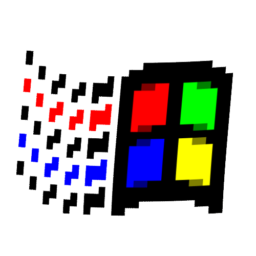
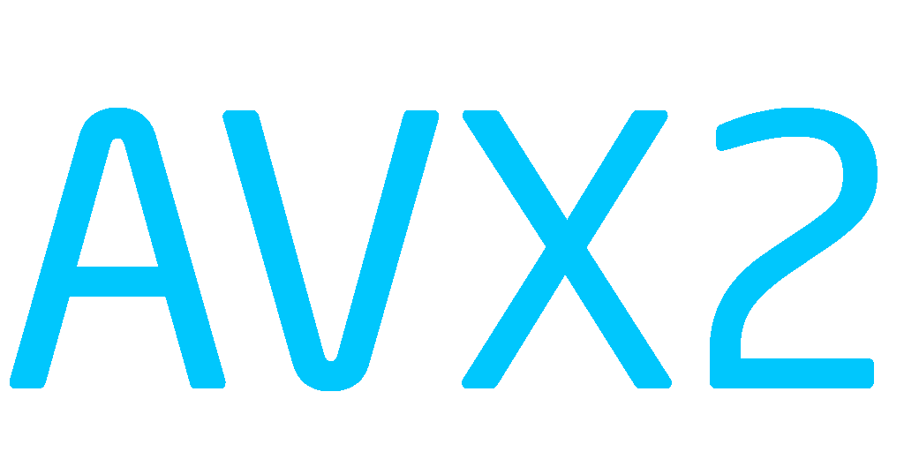
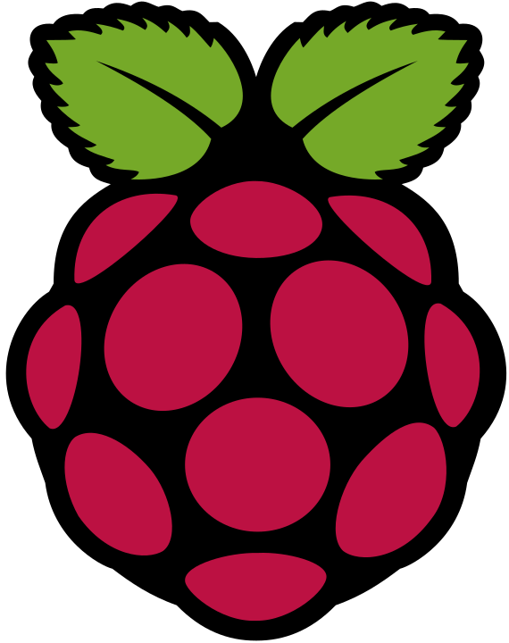

# Thorium

## A cross-platform Chromium fork named after [radioactive element No. 90](https://en.wikipedia.org/wiki/Thorium)

- Targets Chromium stable releases while retaining Thorium's own patches, branding, and defaults.
- Intended to remain familiar to Chrome and Chromium users while exposing additional controls and restoring useful behavior.
- Release builds use compiler and linker optimizations including ThinLTO, PGO, and architecture-aware SIMD profiles. :boom:
  x86 build configurations are available for SSE2, [SSE3](https://en.wikipedia.org/wiki/SSE3), SSE4.1, SSE4.2, [AVX](https://en.wikipedia.org/wiki/Advanced_Vector_Extensions), [AVX2](https://en.wikipedia.org/wiki/Advanced_Vector_Extensions#Advanced_Vector_Extensions_2), and AVX-512. SSE2 is primarily a 32-bit Windows compatibility profile; standard desktop x64 builds use AVX, while explicitly named AVX2 and AVX-512 builds target newer processors. macOS, ARM, and Android builds use their platform-specific configurations instead. Release availability varies by platform and CPU profile.
  If you are unsure which one to download, see the [release and SIMD variant guide](./docs/ABOUT_RELEASES.md).

### Downloads and Platform Releases &nbsp; &nbsp; &nbsp; &nbsp; &nbsp; &nbsp;

This repository contains the shared source and Linux releases. Separate platform repositories distribute additional binaries:

- Linux: [Thorium releases](https://github.com/Alex313031/thorium/releases)
- Windows: [Thorium Win](https://github.com/Alex313031/Thorium-Win)
- Windows on ARM: [Thorium WOA](https://github.com/Alex313031/Thorium-WOA)
- macOS for Apple silicon and Intel x64: [Thorium MacOS](https://github.com/Alex313031/Thorium-MacOS)
- Android ARM32 and ARM64: [Thorium Android](https://github.com/Alex313031/Thorium-Android)
- Raspberry Pi ARM64: [Thorium Raspi](https://github.com/Alex313031/Thorium-Raspi)
- ChromiumOS-based releases: [ThoriumOS](https://github.com/Alex313031/ThoriumOS)
- Windows XP, Vista, 7, 8, and 8.1: [Thorium Legacy](https://github.com/Alex313031/thorium-legacy)
- Linux DEB repository and project website: [thorium.rocks](https://thorium.rocks/)

Choose a build that matches your CPU. A binary compiled for an unsupported SIMD profile may fail before the browser starts. See the [release and SIMD variant guide](./docs/ABOUT_RELEASES.md) before selecting a compatibility or optimized build.

### FEATURES & DIFFERENCES BETWEEN CHROMIUM AND THORIUM  

#### Browser UI and Tabs

- Uses `thorium://` as the user-facing alias for internal pages while retaining canonical `chrome://` compatibility. This includes desktop and Android address-bar surfaces.
- Provides the optional Thorium 2024 UI with translucent inactive tabs, plus classic Omnibox and bookmark styling, rectangular tabs, custom tab widths, expanded theme colors, and platform menu controls. See the [Thorium 2024 UI explainer](./docs/TH24.md).
- Adds extensive tab controls: left- or right-aligned Tab Search, Pin/Unpin Tab Search, Restore Tab, Ctrl+Tab MRU, scrollable tabs, hover activation, custom close-button behavior, double-click/right-click tab closing, and "New tab to the left".
- Adds optional multi-column bookmark menus (`thorium://flags/#multi-column-bookmarks`, off by default; excludes native macOS menus), plus controls for opening bookmarks and address-bar entries in new tabs.
- Restores the classic Download Shelf on Windows, macOS, and Linux via `thorium://flags/#download-shelf`, enables parallel downloading by default, and provides additional download notifications and controls.
- The desktop downloads page shows full URLs by default and includes a copy-link button. Disable `thorium://flags/#downloads-show-full-url` and relaunch to show only Chromium's source information.
- On desktop, a submenu below the default text-search command searches selected text with other engines and active site searches from `thorium://settings/searchEngines`, without changing the default. Selections Chromium treats as URLs keep its "Go to" behavior.
- Adds close confirmation, close-window-with-last-tab, background-mode, quiet-notification, custom New Tab Page, auto-dark-mode, theme, avatar-button, extension-menu, and tab-hover-card controls.

#### Performance and Media

- Restores [FTP](https://en.wikipedia.org/wiki/File_Transfer_Protocol) URL handling and permits saving supported pages from additional schemes.
- Extends media support with FFmpeg HEVC/H.265, MPEG-2, AC-3/E-AC-3, WebRTC H.265 modes, platform media switches, and VAAPI/libva configuration.
- Provides Widevine integration where a supported bundled payload or external CDM is available and redistribution is permitted. Platform details and patch ownership are documented in [PATCHES.md](./docs/PATCHES.md).

#### Privacy and Networking

- Adds and enables [Global Privacy Control](https://globalprivacycontrol.org/), disables Privacy Sandbox defaults, reduces DoH request headers, and offers controls for encrypted ClientHello, history retention, and clearing data on exit.
- Avoids automatically disabling Secure DNS (DoH) solely because a device is managed or has parental controls; explicit DNS policies still apply.
- Prevents URL elision by default, provides Thorium search-engine data and branded search icons, and keeps the local New Tab Page behavior configured by Thorium defaults.
- Disables unwanted startup/default-browser warnings, feature promos, AI entry points, alternate error pages, and remote field-trial fetching by default.

#### Extensions

- Preinstalls classic uBlock Origin when Chromium's preinstall provider processes a new supported profile. Existing profiles are not force-backfilled, and uninstalling it prevents automatic reinstallation.
- Includes Manifest V2 support and increased declarative-net-request limits. On desktop, `thorium://flags/#extensions-menu-quick-toggles` adds quick enable/disable controls to the extensions menu (off by default).
- In extension developer mode, **Install CRX file** on `thorium://extensions` opens a local file picker on desktop and Android. To also install third-party CRX files directly from downloads, enable `thorium://flags/#allow-offstore-extension-downloads`, relaunch, and enable developer mode on the extensions page. This option is off by default; CRX signatures, permission prompts, and extension policies still apply.
- Includes experimental desktop-style extensions on Android, with Incognito support. Enable `thorium://flags/#enable-extensions-android` and relaunch to use them; the feature is off by default.

#### Platform Integration and Tools

- Includes Thorium-branded Windows mini-installer UI, Linux DEB/RPM packaging and desktop integration, ChromeDriver, and `thorium_shell` packaging where supported.
- Offers optional Windows GDI text rendering (`thorium://flags/#force-gdi`, off by default) for compatibility with tools such as MacType. Enabling it relaxes some browser and renderer security protections; see [details](./docs/PATCHES.md#90---windows-gdi-text-rendering-and-native-font-fallbacks-default-off).
- Enables on-device DevTools and Task Manager on Android, including phones, with a More tools menu and touch submenus.
- Includes  [pak](./pak_src/README.md), a cross-platform utility for packing and unpacking Chromium [&#42;.pak](https://textslashplain.com/2022/05/03/chromium-internals-pak-files/) resources.

&nbsp;&plus;&nbsp;Additional patches and useful `thorium://flags` entries are too numerous to list here.

- For ownership and implementation details, read [PATCHES.md](./docs/PATCHES.md). The active patch order is maintained in [`patch_scripts/series/series`](./patch_scripts/series/series).
- Report and track current bugs in the [Thorium issue tracker](https://github.com/Alex313031/thorium/issues).
- A list of Chromium command line flags can be found at > https://peter.sh/experiments/chromium-command-line-switches

## Building  
See [BUILDING.md](./docs/BUILDING.md).

## Debugging 
See [infra/DEBUG](./infra/DEBUG/README.md).

-------

## Team & Credits

&nbsp;&minus; https://www.reddit.com/r/ChromiumBrowser/ is a subreddit I made for Thorium and general Thorium/Chromium discussion, https://thorium.rocks/ is the website I made for it, and https://alex313031.blogspot.com/ is a blog I made relating to Thorium/ThoriumOS. \
&nbsp;&minus; I also build ThoriumOS with Thorium, codecs, Widevine, linux-firmware/modules, and extra packages at > https://github.com/Alex313031/ThoriumOS/

&nbsp;&minus; Project lead: @Alex313031 https://github.com/Alex313031/ \
&nbsp;&minus; Thanks to https://github.com/midzer/ for support and helping with builds. \
&nbsp;&minus; Thanks to https://github.com/gz83/ for support and helping with builds. \
&nbsp;&minus; Thanks to https://github.com/robrich999/ for some info and fixes that went into this project.\
&nbsp;&minus; Also thanks to https://github.com/bromite/bromite, https://github.com/uazo/cromite, https://github.com/saiarcot895/chromium-ubuntu-build, https://github.com/Eloston/ungoogled-chromium, https://github.com/GrapheneOS/Vanadium, and https://github.com/iridium-browser/iridium-browser for patch code. \
&nbsp;&minus; The Rust PAK utility source and the prebuilt binaries in `pak_src/binaries` are credited to @myfreeer: https://github.com/myfreeer/chrome-pak-customizer/

*Thanks for using Thorium!*

 
